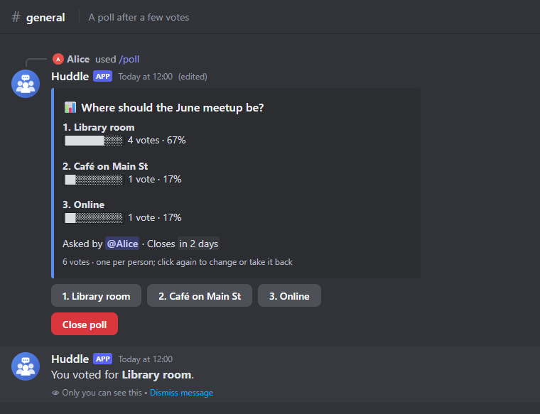
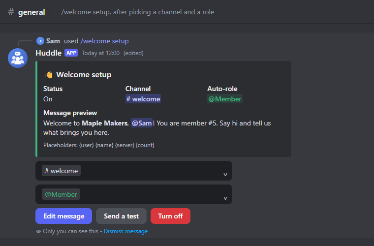
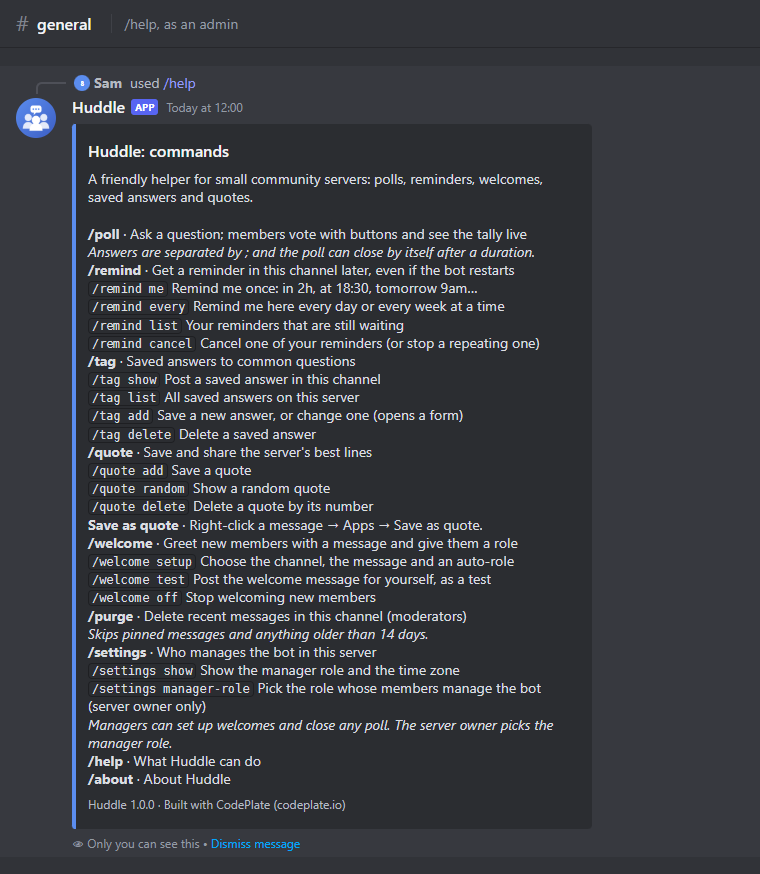
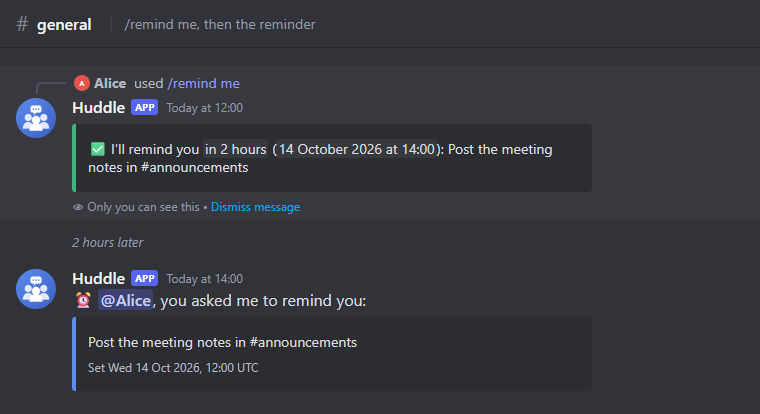
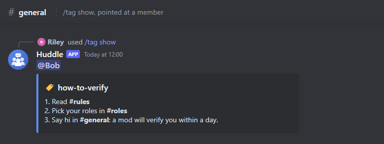

# Discord Bot Starter

> **Free CodePlate template, v1.0.2.** This repository mirrors the zip on [codeplate.io](https://codeplate.io/t/discord-bot-starter/).
> Press **Use this template** to start your own repository from it, or [download the zip](https://codeplate.io/t/discord-bot-starter/).
> [All templates](https://codeplate.io/) · [Free License](https://codeplate.io/license/free/) · subscribers get it under the [Pro License](https://codeplate.io/license/pro/) with no credit.



A finished Discord bot in TypeScript, built so your AI agent can turn it into *your* bot: for a club, a game community, a study group or a company server.

## What's inside

- **Huddle**, a sample community bot:
  - `/poll` with vote buttons and a live tally, closing on a timer
  - `/remind` ("in 2h", "at 18:30", "every Monday at 09:00") that still fires after a restart, in your community's time zone
  - `/welcome` with a setup panel: channel and role menus, a form for the message, an auto-role for new members
  - `/tag` saved answers with autocomplete, `/quote` and a right-click "Save as quote"
  - `/purge` for moderators, with proper permission checks
  - `/settings`: the server owner picks a manager role in Discord; managers run setup commands like `/welcome`
  - `/help` and `/about`
- **A small, clear framework:** one file per command; options declared once with typed, validated values; buttons, menus and forms routed by id; permissions, a manager role and cooldowns checked for you; one-off and weekly jobs that survive restarts and clock changes; per-server settings; SQLite with numbered migrations; JSON logs.
- **Checks with no Discord account:** the real bot runs against a built-in fake Discord, so every command is tested end to end (polls, reminders across restarts, welcomes, permissions) without a token or the internet. One command, about 10 seconds.
- **Screenshots without Discord:** `npm run shots` draws the bot's replies (embeds, buttons, menus, forms) so your agent can see what it built.
- **For your agent:** a brief (`AGENTS.md`), ten step-by-step recipes (new commands, buttons and forms, scheduled jobs, settings, permissions, database tables, AI replies, the Developer Portal and invite, hosting, scaling).

| | |
|---|---|
|  |  |
|  |  |

## Use it with your agent

1. Unzip this folder where you want your project to live.
2. Install [Node.js](https://nodejs.org) 24 or newer.
3. Open the folder with your agent (Claude Code or similar) and say something like:

> This is a Discord bot starter from CodePlate. Read AGENTS.md, then let's make the bot for my book club's server: reading schedules, meeting reminders and discussion polls.

The agent will ask you a few questions, record your decisions in `docs/project.md`, and change the bot step by step, running the checks after each change. When you're ready to try it in Discord, it walks you through creating the application and the invite link.

## Run it yourself

```
npm install
npm run check                 # everything; ends with CODEPLATE CHECKS: PASS
npm run shots                 # screenshots of the replies in shots/
cp .env.example .env          # then fill in DISCORD_TOKEN and DISCORD_APPLICATION_ID
npm run register              # send the commands to Discord
npm run invite                # the link that adds the bot to your server
npm run dev                   # run it (restarts when files change)
```

## License

You can use, modify and run bots made from this template, including commercially. Bots you publish must show the credit "Built with CodePlate (codeplate.io)": the template already puts it in `/about` and the footer of `/help`. You can't resell the template itself. See LICENSE.md. The npm packages it installs keep their own open-source licenses (discord.js and zod are Apache-2.0 and MIT). The avatar was drawn for the template and is yours to use or replace.

Made by [CodePlate](https://codeplate.io). Not affiliated with Discord.
